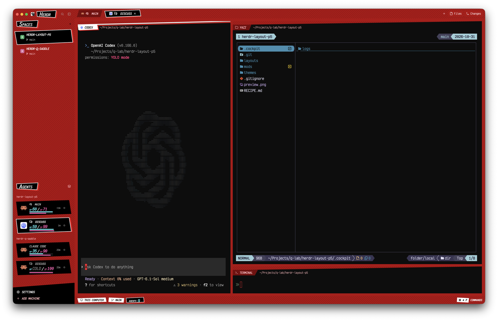

# herdr-layout-p5

A Persona 5 style layout for [herdr-app](https://herdr.dev): deep red striped bars, tilted black selection slabs, slanted pane tops, and agents shown as party cards with HP and SP.



## What's inside

- `layouts/persona5.json`: the layout, with `layouts/persona5.svg` as its picker preview.
- `mods/p5-chrome/wallpaper.jpg`: the window wallpaper, behind 80% opaque bars and see-through panes.
- `themes/persona5.json`: the terminal theme (near-black background, red-leaning ANSI palette).
- `keys/persona5.json`: the layout's quick-terminal shortcut.
- `mods/`: seven mods the layout draws with.
  - `p5-chrome`: the sidebar toolbar, footer and quick-terminal controller.
  - `p5-quick-terminal`: the floating terminal frame and its transparent "端末 Terminal" title PNG.
  - `p5-spaces`: the spaces list, with branch and ahead/behind counts.
  - `p5-agents`: agent party cards with HP (prompt cache time left) and SP (turns left, or context window left).
  - `p5-tabs`: the tab bar.
  - `p5-pane`: the slanted pane header.
  - `p5-status`: the status bar.

## Requirements

- herdr-app 0.1.9 or 0.1.10. The `p5-*` mods are clones of the shipped mods from those versions, so a newer herdr-app may need its changes merged in.
- The shipped mods `files`, `changes`, `menu` and `new-menu`, which herdr-app installs by default.

## Install

Ask your coding agent to install it:

```text
Install the Persona 5 layout from https://github.com/FunnyQ/herdr-layout-p5 by following the Install section of its RECIPE.md.
```

The agent asks you how SP should count, then copies the layout, theme and mods into `~/.config/herdr-app/`.

- **Turns:** SP is 100 minus the turns taken. It reads nothing outside the space folders.
- **Context window:** SP is the percent of the context window left, for Claude Code and Codex. It runs local programs and reads session files under `~/.claude/` and `~/.codex/` (see Privacy).

## Configure

- If your Claude plan uses the default 5-minute prompt cache, set `CACHE_TTL` in `mods/p5-agents/main.js` to `5 * 60000`. It defaults to 60 minutes.

## Quick terminal

Press Control + backtick (`` Ctrl+` ``) to toggle a floating terminal for the active space. Use the monitor button in the sidebar toolbar to open it with the mouse.

Center the 4:3 popup horizontally and vertically when opening it. Draw an irregular black quadrilateral with a white outline and a red offset around the inset terminal. Set the popup's black fill to 80% opacity and all terminal backgrounds to 75% opacity. Dim the workspace behind it with a 35% black backdrop. Place the "端末 Terminal" PNG over its top-left corner to cover the outline's joint. Focus its terminal automatically.

Start each space's first shell in that space's folder. Keep its shell, current directory and running programs when hiding it with the shortcut, the × button or a click outside. Hide it when switching spaces, and reuse it when returning. After exiting the shell, open it again to start a new one.

To move an existing shell pane into Quick Terminal, focus that pane and run `herdr-app do p5-chrome.adopt-quick-terminal`. Remove its pane without terminating its shell. Refuse adoption when that space already has another quick terminal.

## Privacy

`p5-spaces` runs `git status` and `git rev-parse` in each space's folder, and `hc machine ls`, to show branches.

With the context-window SP, `p5-agents` also does this every 15 seconds for each local Claude Code and Codex agent:

- It runs `pgrep`, `ps`, `lsof` and `sqlite3` to find the agent's session.
- It reads `~/.claude/sessions/`, `~/.claude/settings.json`, the session transcripts under `~/.claude/projects/`, `~/.codex/state_*.sqlite`, and the rollouts under `~/.codex/sessions/`.
- It reads only the token counts from those files.

Nothing reaches the network.

## Known limits

- HP counts from the agent's last state change, not its last API call. It is only meaningful for Claude Code.
- The context-window SP takes Claude Code's window from `modelSettings.<model>.autoCompactWindow` in `~/.claude/settings.json`, then a top-level `autoCompactWindow`, then 1M. A 200k model with neither set reads too full.
- The context-window SP finds a Codex session by its `resume` id, else by the newest interactive thread in the agent's folder. Two Codex agents started fresh in the same folder can show the same SP.
- Agents on other machines, and other agents such as OpenCode, keep the turn-based SP.
- On the first run, `p5-agents` stamps every agent "now", so HP and the time are off until each agent changes state once.
- The morphing selection slabs re-render at about 30fps for as long as the layout is loaded. Click `ANIMATION` in the status bar to stop them.

## Design notes

See [RECIPE.md](RECIPE.md) for the full spec: every color, size and shape, how each mod draws, and the pitfalls found while building it.
