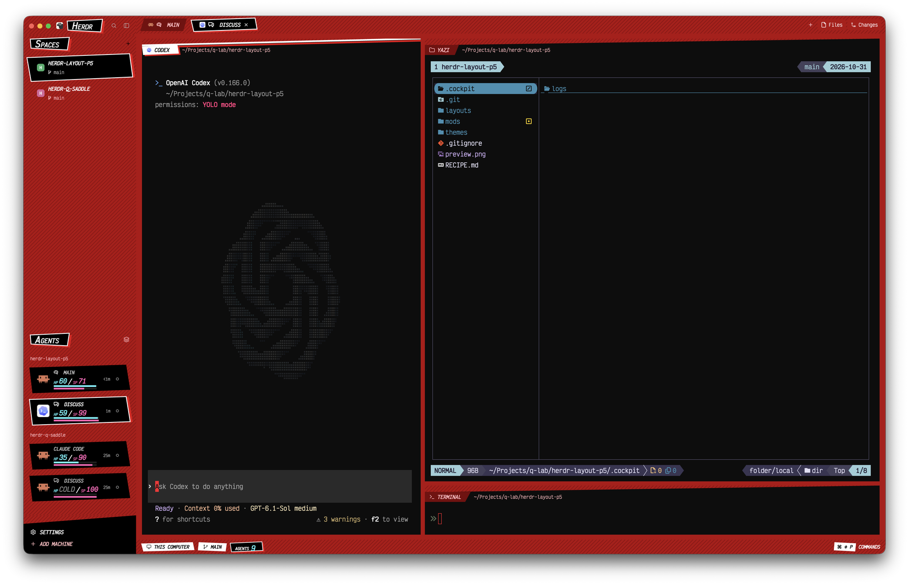

# Persona 5

A herdr-app layout in the style of Persona 5's menus. Every bar is deep red with black diagonal stripes. Whatever is selected sits in a tilted black slab with a white outline and a red copy knocked out behind it. Agents show up as party cards with HP and SP. Terminals stay near-black, and each pane's top edge is cut on a slant.



## What you see

Red is `#b3000e` at 80% opacity (`#b3000ecc`) everywhere, so the wallpaper shows through every bar. Stripes are `#00000040`, 3px wide every 14px, at 45°. "Selected style" means a black irregular quad (corners at different heights), a 2px white outline, and a `#e60012` copy of the quad offset about 5px right and 4px down. On the active space, the focused agent and the active tab, the black quad and its red copy morph: each corner drifts up to about 5px inward on a 2.4s cosine, out of step with the other corners, and the red copy runs half a period behind the black quad. "Unselected style" means a `#7a0009` slant with `#ffb8bd` text. Text is heavy italic caps throughout.

- **Window background** (behind every bar and pane): the wallpaper `mods/p5-chrome/wallpaper.jpg`, a 3840×2160 JPEG, fit `cover`. There are no dividers between regions, so the bars and the sidebar run edge to edge.
- **Sidebar, left, 268px:**
  - **Brand row, 46px** (`p5-chrome`): the Herdr icon, a `HERDR` section tag, and the search and sidebar-toggle buttons. Dragging it moves the window.
  - **Section tags** (`HERDR`, `SPACES`, `AGENTS`): selected-style quads. The first letter is set at 1.45× (23px against 16px), like a ransom-note title.
  - **Spaces** (`p5-spaces`): each row has a colored avatar letter and the name in weight-800 italic caps. Under the name is the branch with ahead/behind counts in `#ffb8bd`.
    - Unselected rows are 46px tall (32px without a branch line) with 12px side padding. Every second row is indented 12px for a zig-zag.
    - The active space is a selected-style quad, 66px tall (48px without a branch line), padded 24px left and 20px right, with a `#bdbdbd` branch line. Its black slab and red copy morph like the focused agent's: each corner drifts inward 2% across and 8% up or down (about 5px), the red copy half a period behind.
    - When any agent in the space is working, a 12px `#ffd400` spinner sits right of the name, left of the blocked `!` or done dot.
  - **Agents** (`p5-agents`): the block grows with its content, from 56px up to 540px, so one card never shows a scrollbar. The focused agent always leads the list in its own `Selected` section, above `Pinned`, and names its space. The default Priority sort then lists sections `Needs you`, `Done`, then `Working` (idle agents are hidden); Grouped by space lists every other agent under its space name. Section labels sit at the right edge, clear of the portraits. Only the display moves: the agent order for next/previous keeps the focused agent in place, or next would bounce between two agents. Each agent is an 84px black irregular card, with 20px above and below:
    - **Left:** a 120px party portrait from `p5-agents/portraits/<program.key>.png` (`claude`, `codex`, `opencode`), in a 62px slot, offset 50px left and 20px up so it breaks over both left corners of the card. Other programs show their icon at 30px inside the card. The portraits are 256px, sharp on 2x screens.
    - **Middle:** the name, then a stat line of 20px weight-900 numbers padded to three digits (`HP 048 SP 015`), the padding zeros at 50% opacity, then two 4px bars, the pink one shifted 10px right of the cyan one:
      - `HP` in `#5ef2ff`: minutes left before the prompt cache goes cold. It is full while the agent is working and counts down from its last state change. It shows a `#ffd400` `0` once the time runs out, or when the agent has never run a turn.
      - `SP` in `#ff5fb4`: 100 minus the turns taken, floored at 0. With the context-window SP, it is the percent of the context window left instead.
      - The cyan bar and the pink bar track HP and SP.
    - **Right:** the time since the state change, then the status icon.
    - **Focused agent:** the card gets the white outline and the red offset copy. Its black slab and its red copy both morph instead of bobbing: each corner drifts up to about 5px inward (2% across, 5px up or down) on a 2.4s cosine, each out of step with the others, and the outline follows the black slab. The red copy keeps its 4px down, 6px right offset and runs half a period (1.2s) behind the black slab, so each of its corners pushes out while the black one pulls in.
    - **Sub-agents:** 26px rows under their parent, joined by 2px black tree lines. Each is a 22px `#8a000b` slant with an 18px portrait or icon, the name in 11px weight-800 italic caps in `#ffb8bd`, and the status icon. The peeked one is a black slant with white text.
  - **Footer, 92px** (`p5-chrome` with `footer: true`): a black block whose top edge slopes up to the right, holding `SETTINGS` and `ADD MACHINE`.
- **Tab bar, 42px** (`p5-tabs`): red with stripes. Tabs are spaced 10px apart and use 13px weight-800 italic caps. The active tab is selected style (32px tall, 20px side padding); the other tabs are unselected style. Files and Changes toggles sit on the right.
- **Panes** (`main`): `#0d0d0d66` (40% opacity) over terminals at 0.6 opacity, 10px gap, no border. Each pane has a 42px header (`p5-pane`) that paints only a slab whose top runs from 38% height on the left up to the top right: red with stripes, overlaid with `#0d0d0d66`. Above the slant the header is transparent, so the wallpaper shows in the wedge. The slab merges with the terminal below, so the pane looks cut on a slant.
  - The focused pane has a 4px white line along the slant, a white irregular name tag with black text, and a red offset copy behind the tag. The white tag is drawn 3px past its 24px row above and below and 6px past it on each side, so it reaches the pane's left edge with no red gap.
  - Other panes have an unselected-style name tag.
  - The folder follows in `#ffb8bd`.
- **Status bar, 34px** (`p5-status`): red with stripes.
  - The machine and branch are white irregular chips with black text, tilted in opposite directions.
  - `AGENTS N` is selected style: a small label with the count at 18px in `#5ef2ff`, plus `/N` in `#ff5fb4` when N agents are blocked.
  - When any agent is blocked, a `N NEEDS YOU!` chip appears in `#ffd400` with black text.
  - On the right is a key chip `ON` or `OFF` followed by `ANIMATION`, then a white key chip `⌘ ⇧ P` followed by `COMMANDS`. Clicking `ANIMATION` flips the shared `p5.motion` flag. Its chip is white with black text while on, and `#7a0009` with `#ffb8bd` text while off.
- **Theme** `themes/persona5.json`: terminal background `#0d0d0d`, foreground `#f2f2f2`, selection `#6b000a`, cursor `#ff1a2d`, and a red-leaning ANSI palette. `colors.border` is `#000000` to hide herdr's overlay frame.
- **Overlays:** the `herdr-q-saddle` overlays (`q-saddle-project`, `q-saddle-ssh`, `q-saddle-tab`) restyle themselves in P5 when `shared('layout') === 'persona5'`.

## How it behaves

- Agent status is shown by an icon: blocked is a `#ffd400` `!` in a 14px `#ffd40026` square on agent cards and space rows (black elsewhere), done a white dot, working a `#ffd400` spinner, and idle a hollow ring.
- Spaces: click to select, drag to reorder, right-click for the menu. The active row is taller, so switching spaces shifts the rows below by about 20px.
- Agents:
  - Clicking a card focuses its pane, and clicking the portrait folds or unfolds its sub-agents.
  - Hovering a card swaps the time for a pin button.
  - The block resizes itself to fit the cards.
- Tabs: click to select, double-click to rename, drag to reorder, and scroll the wheel to switch. The × on the active tab closes it.
- Pane headers: hovering shows the split, zoom and close buttons, and clicking focuses the pane.
- `ctrl-shift-l` cycles layouts, so the person's own layout stays one key away.

## Built from

- `layouts/persona5.json`: a root row of `sidebar` and `work`. The root sets `theme: persona5`, `background: {image: "mods/p5-chrome/wallpaper.jpg", fit: "cover"}`, `terminal_opacity: 0.6`, `titlebar: none` and `traffic_lights: [12, 16]`, and has no `divider`.
  - `sidebar` is a column of `brand`, `sidebar-lists` (holding `spaces` and `agents`) and `sidebar-footer`.
  - `work` is a column of `tabs`, a `work-body` row, and `status`. `work-body` holds `main` and the hidden `panel` stack of `files` and `changes`.
  - The pane frame in `main` is `{gap: 10, radius: 0, background: "#0d0d0d66", border/focus width 0, header {mod: p5-pane, height: 42}, lone: true}`.
- The mods:
  - `p5-tabs`, `p5-pane`, `p5-chrome` and `p5-status` are clones of Herdr 0.1.9's `tabs`, `pane`, `workspace-chrome` and `workspace-status`.
  - `p5-spaces` and `p5-agents` are reworked spaces and agents lists.
- Drawing:
  - Every shape is a `PathBuilder.fill().add_polygon(...)` with percentage coordinates, drawn by `window.paint_path(path, color)` as an `.absolute().inset_0()` child behind the text.
  - Outlines use `PathBuilder.stroke(2).add_polygon(shape, true)`. The slanted pane top uses `PathBuilder.stroke(4).move_to(...).line_to(...)`.
  - The static red offset copies are the same path with `.top(4).left(6).right(-6).bottom(-4)`.
  - The morphing quads (active space, focused agent, active tab) are a nested `Morph` view per layer, made once with `cx.new(Morph, { fill, edge, lag })`. Each rebuilds its polygon from `Date.now() - lag` on its own 33ms timer. When `shared("p5.motion")` is `false`, each renders once at its rest shape, `morphed(0)`, and its timer stops calling `notify`. The red layer sits in a wrapper `div().absolute().top(4).left(6)` (`.left(5)` on the tab) with `lag` set to half the 2.4s period. Corner drift is 2% across and 5px up or down on agent cards (a fixed 84px tall), 2% and 8% on spaces, and 4% and 12% on tabs.
  - Stripes are a full-rect path painted with `Background.pattern_slash("#00000040", 3, 14)`.
- Each mod overrides theme colors locally (`{ ...theme(), chrome: "#b3000ecc", ... }`).
- HP reads a constant `CACHE_TTL` in `p5-agents/main.js`: 60 minutes, for Claude plans with the 1-hour prompt cache. Set it to `5 * 60000` for the default 5-minute cache.
- SP comes from `p5-agents/sp.js`, which install copies from one of two files. Both export `startSp(cx)` and `sp(address, turn)`. `sp.js` is gitignored.
  - `sp-turns.js`: `100 - turn`, where `turn` comes from `terminals()`, the same field `hc ls --json` reports.
  - `sp-context.js`: `100 - used / window × 100`, read from each local agent's session files every 15 seconds. Any agent it can't read keeps `100 - turn`.
- How `sp-context.js` finds the numbers:
  - **Agent process:** `terminals()` gives each terminal's `program.key` (`claude`, `codex`) and its shell's `pid`. `pgrep -P` gives the agent under the shell. `terminals()` has no `agent` field, unlike `hc ls --json`.
  - **Claude Code:** read `~/.claude/sessions/<pid>.json` for `sessionId` and `cwd`, then read `~/.claude/projects/<cwd with every non-alphanumeric as ->/<sessionId>.jsonl`. Used is the last non-sidechain, non-`<synthetic>` assistant message's `usage.input_tokens + cache_read_input_tokens + cache_creation_input_tokens`. The window is `modelSettings.<model>.autoCompactWindow` in `~/.claude/settings.json`, then a top-level `autoCompactWindow`, then 1M.
  - **Codex:** all Codex TUIs write through one shared `codex app-server`, so `lsof` on the agent finds no rollout. Take the thread id from a `resume <id>` in the agent's argv, else the newest `threads` row in `~/.codex/state_*.sqlite` with the agent's cwd and `source` `cli` or `vscode`. Its `rollout_path`'s last `token_count` event has `info.last_token_usage.input_tokens` (used, already including cached input) and `info.model_context_window` (window).
  - Only the last matching lines are read (`grep -F | tail -n 20`): transcripts outgrow `readTextFile`'s 1 MiB limit.
  - `tests/sp-context.test.js` covers the parsing. Run it with `bun test`.
- Icons load from the shipped mods' folders (`mods/workspace-chrome/`, `mods/pane/`, `mods/tabs/`).
- Uses the shipped mods `files`, `changes`, `menu` and `new-menu`.
- **Runs programs:** `p5-spaces` runs `git status` / `git rev-parse` in each space's folder, local or remote, to show branches, and calls `hc machine ls`. With `sp-context.js`, `p5-agents` runs `pgrep`, `ps`, `lsof` and `sqlite3`, and reads files under `~/.claude/` and `~/.codex/`. Nothing reaches the network.

## Watch out

- A pane frame can only be a rectangle, and a header mod can't draw over it. That is why the slant is a header slab the same color as the terminal, and why a focus border can't follow the slant.
- A theme file color must be `#rrggbb`. One `#rrggbbaa` value makes the whole layout fail to apply (`... is not #rrggbb`).
- `.loop()` does not animate a `paint_path` element directly. Wrap the path in a `div()` with an `.id(...)` and put `.loop()` on the wrapper.
- The `Morph` timers for the active space, focused agent and active tab re-render at about 30fps for as long as the mods are loaded, even with nothing selected on screen. With animation off, the timers still wake every 33ms but skip the render.
- `.loop()` animates only `left`, `top`, `width`, `height` and `opacity`, never a path's points. A morphing shape needs its own nested view that rebuilds the path on a timer; keep it out of the parent's render so a frame rebuilds only that view.
- `colors.border: "#000000"` also blacks out every other use of `t.border`: the separators in `menu` and `new-menu` vanish against the `#000000` popover, and the frames and dividers in `files` and `changes` nearly vanish against `#0d0d0d`.
- The Agents block sizes itself with `layout.resize`. Count its 53px title row, 28px bottom row, 30px per section header, 124px per card, 26px per unfolded sub-agent and 8px for the red copy, or one card shows a scrollbar.
- `line_height` given a bare number is a multiplier (`1.1`), not pixels.
- Herdr doesn't notice edits behind a symlinked mod or layout, and a symlinked mod can't load SVGs from its own folder. Switch layouts (`ctrl-shift-l`) to reload.
- When `layouts/persona5.svg` is a symlink, the layout picker shows an empty preview card. Copy the file into `~/.config/herdr-app/layouts/` instead of linking it.
- `herdr` exports a `window()` function, while the drawing `window` is gpui-kit's global. Import herdr's as `window as appWindow`, or call `globalThis.window.paint_path`.
- `p5-agents` keeps state-change times in its own `localStorage`. On its first run every agent is stamped "now", so HP and the time are off until each agent changes state once.
- HP counts from the agent's last state change, not its last API call, and it means nothing for agents that aren't Claude Code.
- `herdr-app check` runs the mod's `init` too, so a side effect seen after a check may come from the check, not the window. Confirm a change in the window with a screenshot (`herdr-app shot`).
- After a mod folder changes from a symlink to a copy, Herdr keeps the old build until a layout switch.
- Run `pgrep` from inside an agent's own terminal and it finds nothing: macOS `pgrep` skips its own ancestors. Test `sp-context.js` from outside the agent you are looking at.
- Percentage-based slants get flatter on longer labels.
- The zig-zag indent follows list order, so adding or dragging a space shifts which rows indent.
- After a mod reloads, the branch lines take a few seconds to come back while git is asked again.
- The four clones track Herdr 0.1.9; a newer Herdr may need its changes merged in.

## Install

Follow these steps to install the layout for someone. Run them from a clone of this repo.

1. Ask the person how SP should count, and wait for the answer:
   - **Turns:** 100 minus the turns taken. It reads nothing outside the space folders.
   - **Context window:** the percent of the context window left, for local Claude Code and Codex agents. Before they choose, tell them it runs `pgrep`, `ps`, `lsof` and `sqlite3` every 15 seconds, and reads files under `~/.claude/` and `~/.codex/`.
2. Copy the layout, theme and mods.

   ```sh
   cp layouts/persona5.json layouts/persona5.svg ~/.config/herdr-app/layouts/
   cp themes/persona5.json ~/.config/herdr-app/themes/
   cp -R mods/p5-* ~/.config/herdr-app/mods/
   ```

3. Copy the chosen SP file to `sp.js`: `sp-turns.js` for turns, `sp-context.js` for the context window.

   ```sh
   cp ~/.config/herdr-app/mods/p5-agents/sp-turns.js ~/.config/herdr-app/mods/p5-agents/sp.js
   ```

4. Check each mod. Without `sp.js`, `p5-agents` fails to load.

   ```sh
   for m in ~/.config/herdr-app/mods/p5-*; do herdr-app check "$m"; done
   ```

5. Tell the person to switch to the layout from the layout picker, or to press `ctrl-shift-l` until Persona 5 shows.
6. If their Claude plan uses the default 5-minute prompt cache, set `CACHE_TTL` in `~/.config/herdr-app/mods/p5-agents/main.js` to `5 * 60000`.

Copy files rather than symlinking them. Herdr doesn't notice edits behind a symlinked mod or layout, and a symlinked `persona5.svg` shows an empty card in the layout picker.

## Done when

- `herdr-app check mods/<name>` passes for all six `p5-*` mods.
- `herdr-app status` shows `"errors": []` after `layout.switch {"name":"persona5"}`.
- A screenshot shows:
  - striped red bars with no divider lines
  - selected-style quads on the section tags, the active tab, the active space and the focused agent
  - a slanted top on every pane, with a white line on the focused one
- An agent that has never run a turn shows `HP 0 / SP 100`.
- `bun test` passes.
- With `sp-context.js`, a Claude Code agent's SP is within 2 of `100 - /context`'s used percent of its window.
- Blocking an agent shows the yellow `NEEDS YOU!` chip in the status bar.
